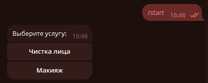
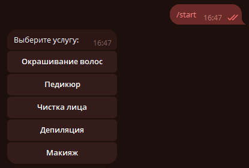

# Telegram-бот с динамическим меню услуг (n8n)

Решение тестового задания LD LATTE: Telegram-бот на базе n8n Cloud, формирующий динамическое inline-меню активных услуг на основе Google Таблицы.

* **Тестовая Google Таблица:** [Открыть таблицу](https://docs.google.com/spreadsheets/d/1cOWvfi8D-Kyd-eLu8oHBrlbB7rGw_leULPt8JSDrCHE/edit?usp=sharing)
* **Файл воркфлоу:** [Telegram-Bot.json](Telegram-Bot.json)

---

## 1. Структура Google Таблицы

Таблица содержит перечень услуг и признак их доступности:

| Колонка | Тип | Описание | Пример |
| :--- | :--- | :--- | :--- |
| `id` | Число / Строка | Уникальный идентификатор услуги (передаётся в `callback_data`) | `1` |
| `name` | Строка | Название услуги, отображаемое на кнопке и в ответе бота | `Чистка лица` |
| `active` | Логический | Флаг активности (`TRUE` / `FALSE`, также поддерживаются `1`, `yes`, `да`, `+`) | `TRUE` |

---

## 2. Архитектура и логика воркфлоу

Воркфлоу построен по схеме единого процесса с разделением событий через узел `If`:

1. **Входная точка (`Telegram Trigger1`):**
   Принимает два типа апдейтов: входящие текстовые сообщения (`message`) и нажатия на кнопки (`callback_query`). Нода `Is button click` разделяет поток.

2. **Ветка команды `/start` (формирование меню):**
   * **`Is /start command`:** проверяет текст сообщения на команду `/start`.
   * **`Read GoogleSheets1`:** заново читает актуальные строки из таблицы при каждом вызове.
   * **`Keyboard` (Code-нода):** фильтрует только строки с `active = TRUE`, формирует массив inline-кнопок (по одной кнопке в ряду) с `callback_data = id`.
     * Если активных услуг нет — возвращает текст *«К сожалению, сейчас нет доступных услуг. Загляните позже.»* без клавиатуры.
   * **`Send Inline` (HTTP Request):** отправляет запрос к Telegram Bot API (`sendMessage`). Сборка через HTTP Request необходима, так как стандартная нода Telegram в n8n не принимает произвольный динамический JSON `reply_markup` с переменным числом кнопок.

3. **Ветка клика по кнопке (`callback_query`):**
   * **`Read GoogleSheets`:** повторно запрашивает таблицу на момент клика.
   * **`Find service` (Code-нода):** находит услугу по `callback_data` (ID) и проверяет, активна ли она в данный момент.
     * Если услуга активна — формирует сообщение: *«Вы выбрали услугу: <Название>»*.
     * Если услугу успели отключить в таблице — сообщает: *«Эта услуга больше недоступна. Отправьте /start, чтобы обновить меню.»*.
   * **`Callback` (`answerCallbackQuery`):** снимает индикатор загрузки (часики) с нажатой кнопки в интерфейсе Telegram.
   * **`Send Services`:** отправляет итоговое текстовое сообщение пользователю.

Количество и состав кнопок определяются исключительно данными из таблицы — редактирование воркфлоу при изменении услуг не требуется.

---

## 3. Инструкция по импорту и запуску в n8n

1. Откройте n8n и перейдите в раздел **Workflows**.
2. Создайте новый воркфлоу и выберите **Import from File...** (или нажмите `Ctrl+V`), указав файл [Telegram-Bot.json](Telegram-Bot.json).
3. Настройте подключения (Credentials):
   * В ноде `Bot config` укажите токен вашего Telegram-бота в поле `botToken`, а также привяжите `telegramApi` в нодах `Telegram Trigger1`, `Callback` и `Send Services`.
   * В нодах `Read GoogleSheets` и `Read GoogleSheets1` выберите аккаунт `googleSheetsOAuth2Api` и укажите ID вашей таблицы.
4. Включите переключатель **Active** в правом верхнем углу воркфлоу.
5. Отправьте боту команду `/start` в Telegram.

---

## 4. Демонстрация работы

| Состояние меню | Скриншот |
| :--- | :--- |
| **Меню с 2 активными услугами** |  |
| **Меню с 5 активными услугами** |  |
| **Меню с 9 активными услугами** |  |

* **Выбор услуги:** при нажатии на любую активную кнопку бот снимает индикатор загрузки и присылает сообщение с её названием.
* **Пустой список:** при отключении всех строк бот отвечает: *«К сожалению, сейчас нет доступных услуг. Загляните позже.»*.
* **Защита от изменений:** если услуга была отключена в таблице уже после отправки меню, бот информирует о недоступности и предлагает обновить список через `/start`.

---

## 5. Ограничения и развитие

При высокой нагрузке обращение к Google Sheets при каждом клике может упереться в квоты Google API. Для production-нагрузки оптимально:
- Заменить Google Sheets на реляционную базу данных (PostgreSQL) или кэшировать список услуг в Redis с TTL (1–5 минут).
- Использовать Webhooks Google Таблиц для инвалидации кэша только при реальном изменении строк.
