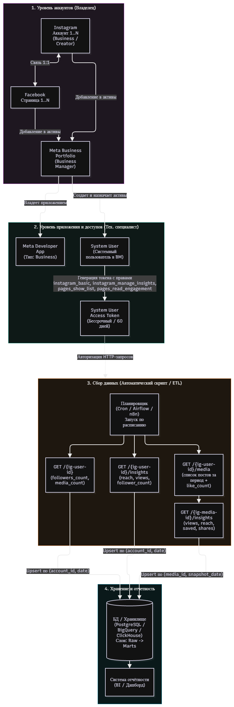

# План подключения Instagram-аккаунтов для автоматического сбора статистики

Для автоматического сбора статистики из нескольких аккаунтов Instagram используется официальный **Instagram Graph API** (поверх **Meta Graph API**). В актуальных версиях API (v20.0–v22.0) существует два пути авторизации:
1. Классический через связку с Facebook Page (**Instagram API with Facebook Login**).
2. Прямой через **Instagram API with Instagram Login** (Business Login for Instagram).

Для корпоративной задачи с несколькими аккаунтами и фоновым сбором данных на серверной стороне надежнее использовать связку через **Meta Business Portfolio (бывший Business Manager)** и **System User Token (токен системного пользователя)**. Такие токены не привязаны к конкретному человеку, не истекают при смене пароля или увольнении сотрудника и позволяют централизованно опрашивать все аккаунты компании через единый ключ доступа.

Ниже представлен полный план реализации, проверенный по спецификации Meta Graph API.

---

## 1. Визуальная схема реализации (Архитектура и поток данных)

---

## 2. Предварительные условия, связи и токены

### 1. Тип аккаунта Instagram
Только профессиональные аккаунты (**Business** или **Creator**). Личные аккаунты закрыты для сбора статистики через официальный API.

### 2. Связь с Facebook и Business Portfolio
* При использовании корпоративного **System User Token** каждый Instagram-аккаунт должен быть привязан к отдельной странице Facebook (связь $1:1$).
* Все страницы Facebook и аккаунты Instagram добавляются в единый **Meta Business Portfolio** (бывший Facebook Business Manager) компании.
* *Примечание об альтернативном способе:* Доступен вход напрямую через Instagram (*Instagram API with Instagram Login* без страницы Facebook), где выдается 60-дневный токен (`ig_exchange_token`) со скоупами `instagram_business_basic` и `instagram_business_manage_insights`. Однако там отсутствует концепция System User: каждый аккаунт придется авторизовывать отдельно через OAuth-окно владельца и программно обновлять токен каждые 60 дней. Для нескольких аккаунтов компании схема через Business Portfolio и Facebook Page значительно надежнее и проще в поддержке.

### 3. Разрешения (Permissions / Scopes)
* `instagram_basic` — базовое чтение профиля, количества подписчиков и списка публикаций.
* `instagram_manage_insights` — чтение метрик (инсайтов) аккаунта, публикаций и Stories.
* `pages_show_list` — получение списка привязанных страниц Facebook и обнаружение `instagram_business_account` ID.
* `pages_read_engagement` — обязательное сопутствующее разрешение для чтения данных через привязанную страницу Facebook.
* `business_management` — опционально, если требуется программно управлять или запрашивать список активов напрямую из узла Business Manager.

> **Нужен ли App Review (проверка приложения в Meta)?**
> **Нет**, если приложение находится в том же Business Portfolio, которому принадлежат аккаунты (или имеет к ним партнерский доступ), а запросы выполняются с токеном администратора / System User этого же бизнеса. Статус доступа **Standard Access** позволяет без ограничений читать статистику всех собственных аккаунтов компании без прохождения модерации Meta.

### 4. Токены и поддержание доступа
* **Краткоживущий токен пользователя (Short-lived User Token):** живет 1–2 часа.
* **Долгоживущий токен пользователя (Long-lived User Token):** живет 60 дней, требует регулярного обновления (`fb_exchange_token`), аннулируется при смене пароля пользователя или выходе из сессии.
* **Токен системного пользователя (System User Access Token) — рекомендуемый вариант:** создается внутри настроек Business Portfolio в разделе «Системные пользователи». Не привязан к учетной записи конкретного человека, не сбрасывается при смене пароля или увольнении сотрудника, может быть выпущен **без срока истечения** (Never Expire) либо со сроком 60 дней и программным обновлением. Один такой токен открывает доступ сразу ко всем аккаунтам Instagram, назначенным этому системному пользователю.

---

## 3. Пошаговый план реализации

### Этап 1. Действия владельца аккаунтов (или администратора соцсетей)
1. Перевести все целевые аккаунты Instagram в статус **Профессиональный** («Бизнес» или «Автор») в настройках мобильного приложения Instagram.
2. Создать (если отсутствует) корпоративный **Meta Business Portfolio** на портале `business.facebook.com`.
3. Для каждого Instagram-аккаунта создать страницу Facebook (если её ещё нет) и связать их между собой (*Настройки Instagram $\rightarrow$ Аккаунт $\rightarrow$ Связанные аккаунты $\rightarrow$ Facebook*, либо через интерфейс *Meta Business Suite*).
4. Добавить все страницы Facebook и аккаунты Instagram в Meta Business Portfolio компании в разделы **«Страницы» (Pages)** и **«Аккаунты Instagram» (Instagram accounts)**.
5. Выдать техническому специалисту права администратора (**Full Control / Manage**) в этом Business Portfolio (или права разработчика с доступом к назначению активов).

### Этап 2. Настройка со стороны технического специалиста
1. Перейти на `developers.facebook.com`, создать новое приложение, выбрать сценарий **Другое (Other)** $\rightarrow$ тип **Бизнес (Business)** и привязать его к Meta Business Portfolio компании.
2. Перейти в настройки Business Portfolio (`business.facebook.com/settings`) $\rightarrow$ **Пользователи** $\rightarrow$ **Системные пользователи (System Users)**.
3. Создать системного пользователя с ролью **Администратор (Admin)**.
4. Нажать **Назначить объекты (Assign Assets)** для созданного системного пользователя:
   * Выбрать все целевые **Страницы Facebook** и включить переключатель «Полный контроль» (или частичный доступ к просмотру эффективности и управлению контентом).
   * Выбрать все **Аккаунты Instagram** и отметить доступ к статистике (**View insights** / Управление).
   * Выбрать созданное **Приложение (App)** и выдать полный контроль.
5. Нажать **Создать новый маркер (Generate New Token)** в карточке системного пользователя:
   * Выбрать созданное приложение.
   * Установить срок действия маркера (**«Никогда» / Never** или 60 дней в зависимости от политик безопасности Business Portfolio).
   * Отметить разрешения: `instagram_basic`, `instagram_manage_insights`, `pages_show_list`, `pages_read_engagement`.
   * Скопировать сгенерированный токен и сохранить его в защищенное хранилище секретов (HashiCorp Vault, AWS Secrets Manager или `.env` на сервере).
6. Выполнить первичный дискаверинг (получить внутренние идентификаторы аккаунтов Instagram — `ig_user_id`):
   * Отправить запрос (с учетом лимита пагинации `limit=100`):
     `GET https://graph.facebook.com/v22.0/me/accounts?fields=id,name,instagram_business_account{id,username}&limit=100&access_token={TOKEN}`
   * Из ответа извлечь `instagram_business_account.id` для каждого аккаунта и сохранить справочник (маппинг) в базу данных.

### Этап 3. Автоматический сбор и сохранение (ETL-скрипт)
1. **Запуск по расписанию (Cron / Airflow / n8n):**
   * Основной пайплайн запускается 1 раз в сутки (оптимально утром по UTC, так как суточные агрегаты Meta закрывает по тихоокеанскому времени PST/PDT или UTC в зависимости от метрики).
   * Если требуется сбор статистики по **Stories**, дополнительный легкий джоб запускается каждые 12 часов.
2. **Обход всех активных аккаунтов из БД в цикле:**
   * **Шаг А (Снимок профиля):** запрос текущего числа подписчиков (`followers_count`) и общего числа публикаций (`media_count`), запись в таблицу `account_daily_snapshots` на текущую дату.
   * **Шаг Б (Метрики аккаунта):**
     * Запрос временных рядов (`period=day`) для охвата (`reach`) и прироста подписчиков (`follower_count`) за последние 2–3 дня (запрос с перекрытием позволяет скорректировать возможные задержки пересчета данных на стороне Meta).
     * Запрос агрегированных просмотров аккаунта (`metric=views&metric_type=total_value&period=day`) за каждый из последних 2–3 дней (передавая `since` и `until` с шагом в 1 сутки).
   * **Шаг В (Список и метрики публикаций):** запрос постов, Reels и каруселей (`GET /{ig-user-id}/media`), вышедших за последние 30 дней (или глубже при первичной исторической выгрузке) с проходом по курсорам пагинации (`paging.next`). Для оптимизации сетевых вызовов базовые поля (`like_count`, `comments_count`) и глубокие инсайты (`views`, `reach`, `saved`, `shares`) можно запрашивать как раздельно, так и в одном вызове через механизм **Field Expansion**:
     `GET /{ig-user-id}/media?fields=id,caption,media_type,media_product_type,timestamp,permalink,like_count,comments_count,insights.metric(views,reach,saved,shares,total_interactions)`
   * **Шаг Г (Сторис — при необходимости):** опрос эндпоинта `GET /{ig-user-id}/stories` с вложенным чтением инсайтов до истечения 24 часов с момента публикации.
3. **Идемпотентная запись в БД:** использование операции `UPSERT` (`INSERT ... ON CONFLICT DO UPDATE`) по композитному ключу `(account_id, metric_date)` для дневной статистики аккаунта и `(media_id, snapshot_date)` (или обновление актуального состояния `media_id`) для публикаций, чтобы повторные запуски скрипта обновляли цифры, не создавая дубликатов.

---

## 4. Таблица метрик, способов получения и ограничений

> **Важное изменение в спецификации API Meta (v20.0–v22.0):**
> Метрики `impressions` (показы) и `profile_views` (просмотры профиля) признаны устаревшими (**deprecated**). Вместо `impressions` Meta ввела единую сквозную метрику **`views` (просмотры)** как на уровне аккаунта, так и для всех типов медиаконтента (Reels, фото, карусели, Stories).

| Показатель | Эндпоинт и параметры | Доступный период / Агрегация | Условия и жесткие ограничения API |
| :--- | :--- | :--- | :--- |
| **Общее кол-во подписчиков** | `GET /{ig-user-id}?fields=followers_count,media_count` | Только текущее значение (на момент запроса, `lifetime`) | Исторических данных в API нет. Чтобы строить динамику общего числа подписчиков, необходимо ежедневно сохранять срез в собственную БД. |
| **Прирост подписчиков за день** | `GET /{ig-user-id}/insights?metric=follower_count&period=day` | По дням (`period=day`, формат `time_series`) за последние 30 дней | **Строгий порог:** минимум $100$ подписчиков на аккаунте. Если меньше $100$ — API вернет ошибку или пустой ответ. Не отдает данные старше 30 дней от текущей даты (не учитывает отписки отдельно, показывает чистый прирост/динамику). |
| **Охват аккаунта (Reach)** | `GET /{ig-user-id}/insights?metric=reach&period=day` | `period=day`, `week`, `days_28`. История до 2 лет (запрос окнами до 30 дней за раз через Unix-таймстампы `since` и `until`) | Считает **уникальные** аккаунты. Нельзя математически суммировать дневной `reach` за 30 дней в БД, чтобы получить месячный охват (один и тот же зритель в разные дни будет посчитан несколько раз). Для уникального охвата за неделю/месяц запрашиваются отдельные периоды `week` и `days_28`. |
| **Просмотры контента аккаунта (Views)** | `GET /{ig-user-id}/insights?metric=views&metric_type=total_value&period=day&since={ts}&until={ts}` | Агрегат `total_value` за окно `since–until` (история до 2 лет, макс. окно за запрос — 30 дней) | Заменила собой `impressions`. Суммирует все просмотры постов, Reels и Stories аккаунта. Так как требует `metric_type=total_value`, возвращает сумму за переданный интервал `since–until`. Для подневной разбивки скрипт запрашивает интервалы по 24 часа. |
| **Базовые показатели поста (Лайки, Комментарии)** | `GET /{ig-user-id}/media?fields=id,caption,media_type,media_product_type,timestamp,permalink,like_count,comments_count` | Накопительно за всё время жизни публикации (`lifetime`) | Доступно для всех постов. Даже если автор скрыл счетчик лайков в публичном интерфейсе приложения, при запросе с токеном владельца поле `like_count` вернет точное число. |
| **Глубокая статистика поста (Просмотры, Охват, Сохранения, Репосты)** | `GET /{ig-media-id}/insights?metric=views,reach,saved,shares,total_interactions` | Накопительно за всё время жизни публикации (`lifetime`) | Доступно для постов, опубликованных после перевода аккаунта в статус Business/Creator (история инсайтов — до 2 лет). Для каруселей (`CAROUSEL_ALBUM`) метрики запрашиваются у родительского объекта, а не у вложенных карточек `children`. |
| **Статистика Stories** | `GET /{ig-user-id}/stories` $\rightarrow$ `GET /{story-id}/insights?metric=views,reach,replies,shares,navigation` | Только пока история активна ($24$ часа с момента публикации) | Если у Stories мало взаимодействий (например, меньше 5 ответов — порог приватности Meta), часть метрик может вернуться с нулями или пустым массивом. Через 24 часа объект исчезает из `/stories` (требуется опрос раз в 8–12 часов или подписка на Webhooks). |

### Общие лимиты запросов (Rate Limits)
Для Instagram Graph API применяются квоты **Business Use Case (BUC)**: лимит составляет **$200$ запросов в час на один бизнес-аккаунт Instagram (`ig-user-id`)**. Квота изолирована для каждого отдельного аккаунта. При использовании вложенных запросов (Field Expansion) сбор полной суточной статистики одного аккаунта занимает всего 4–6 HTTP-запросов, что с огромным запасом укладывается в лимиты при любом количестве аккаунтов.

---

## 5. Типичные проблемы и план проверки (Диагностика)

### План поэтапной проверки (Чек-лист перед запуском)

1. **Проверка токена, срока действия и разрешений:**
   * Отправить запрос к инспектору токенов:
     `GET https://graph.facebook.com/debug_token?input_token={TOKEN}&access_token={TOKEN}` (либо проверить через веб-инструмент *Access Token Debugger*).
   * *Критерий успеха:* `is_valid: true`, `expires_at: 0` (бессрочный), в массиве `scopes` присутствуют `instagram_basic`, `instagram_manage_insights`, `pages_show_list`, `pages_read_engagement`, а в `granular_scopes` перечислены ID всех целевых страниц и IG-аккаунтов.
2. **Проверка видимости всех аккаунтов и связки с Facebook Pages:**
   * Выполнить запрос:
     `GET https://graph.facebook.com/v22.0/me/accounts?fields=name,instagram_business_account{id,username,followers_count}&limit=100&access_token={TOKEN}`
   * *Критерий успеха:* В JSON-ответе присутствуют все аккаунты компании, и внутри каждого объекта страницы присутствует заполненный узел `instagram_business_account` с `id` и `followers_count`.
3. **Проверка чтения инсайтов уровня аккаунта:**
   * Выполнить тестовые запросы для каждого `ig-user-id`:
     * `GET /v22.0/{ig-user-id}/insights?metric=reach&period=day`
     * `GET /v22.0/{ig-user-id}/insights?metric=views&metric_type=total_value&period=day&since={yesterday_ts}&until={today_ts}`
   * *Критерий успеха:* Код ответа `200 OK`, внутри `data` возвращаются числовые значения метрик.
4. **Проверка чтения публикаций и их инсайтов:**
   * Выполнить запрос:
     `GET /v22.0/{ig-user-id}/media?fields=id,media_type,like_count,comments_count,insights.metric(views,reach,saved,shares)&limit=5`
   * *Критерий успеха:* Код ответа `200 OK`, у постов возвращаются как базовые счетчики, так и массив `insights.data`.

### Частые проблемы и способы их выявления

* **Проблема 1: В ответе `/me/accounts` есть страница Facebook, но отсутствует поле `instagram_business_account`.**
  * *Причина А:* Аккаунт Instagram не переведен в профессиональный режим (остался личным).
  * *Причина Б:* Связь между Facebook Page и Instagram-аккаунтом не завершена (висит плашка «Требует подтверждения» / *Confirm connection* в настройках привязанных аккаунтов на Странице Facebook).
  * *Причина В:* Системному пользователю в Business Portfolio назначили актив «Страница Facebook», но забыли назначить сам актив в разделе «Аккаунты Instagram».
* **Проблема 2: Ошибка `(#100) Incompatible metrics` или `metric ... must be specified with metric_type=total_value`.**
  * *Причина:* В версиях Graph API v20.0+ метрики `views`, `total_interactions`, `profile_links_taps` требуют обязательного параметра `&metric_type=total_value`, в то время как `reach` и `follower_count` запрашиваются как временные ряды (`metric_type=time_series` или без параметра). Их нельзя смешивать в одном HTTP-запросе — необходимо разделить их на два отдельных вызова.
* **Проблема 3: Ошибка при запросе `follower_count` или демографии (`Error 100: Not enough data`).**
  * *Причина:* На аккаунте меньше $100$ подписчиков.
  * *Решение:* Скрипт должен проверять условие `followers_count >= 100` из Шага А перед запросом `follower_count`, либо обрабатывать это исключение, записывая `NULL` в БД без прерывания работы всего пайплайна.
* **Проблема 4: Нет данных по приросту подписчиков за прошлые месяцы.**
  * *Причина:* Эндпоинт `follower_count` в API физически не отдает историю глубже 30 дней от момента запроса. Историческая динамика подписчиков накапливается в собственной БД с момента запуска интеграции.
* **Проблема 5: Ошибка при запросе инсайтов у старых публикаций или промо-постов.**
  * *Причина:* Пост был опубликован до того, как аккаунт перевели в статус Business/Creator, либо прошло более 2 лет. Для таких публикаций доступны только базовые поля (`like_count`, `comments_count`), а узел `/insights` вернет ошибку (скрипт должен корректно перехватывать её и сохранять только базовые поля).

---

## 6. Список вопросов к компании до начала работы

Чтобы спроектировать точную схему таблиц в БД и приступить к настройке без переделок, необходимо уточнить у заказчика следующие вопросы:

### 1. Количество и текущий статус аккаунтов
* Сколько всего Instagram-аккаунтов необходимо подключить на старте и как часто планируется добавление новых?
* Переведены ли уже все целевые аккаунты в профессиональный режим («Бизнес» или «Автор») и есть ли на каждом из них минимум $100$ подписчиков?

### 2. Инфраструктура Meta
* Есть ли у компании единый корпоративный **Meta Business Portfolio (Business Manager)**, или аккаунты сейчас разрознены и привязаны к личным профилям сотрудников?
* Создана ли и привязана ли к каждому Instagram-аккаунту собственная страница Facebook?
* Кто со стороны компании является главным администратором Business Portfolio и сможет выполнить привязку активов (или выдать административный доступ техническому специалисту)?

### 3. Глубина, частота и состав метрик
* Требуется ли собирать статистику по **Stories**? *(От этого зависит частота запуска сборщика: 1 раз в сутки для постов/Reels или каждые 8–12 часов для перехвата Stories до их исчезновения через 24 часа).*
* За какой исторический период необходимо выгрузить старые публикации при первом запуске (за последние 30 дней, за год, за 2 года)?
* Нужна ли для старых постов (вышедших более 30 дней назад) ежедневная перезапись их статистики (для отслеживания «длинного хвоста» просмотров Reels), или достаточно обновлять только публикации за последние 30 дней?
* Как именно в отчетах должен отображаться **охват (Reach)** аккаунта: только подневный график или также дедуплицированные уникальные охваты за неделю (`week`) и 28 дней (`days_28`)?
* Нужно ли разделять органические показатели и рекламные (продвижение постов через Meta Ads Manager)? *(Если да — потребуется дополнительное разрешение `ads_read` и доступ к рекламным кабинетам `ad_accounts`).*

### 4. Технический стек и целевая система отчётности
* Что выступает в роли «общей системы отчётности» (СУБД PostgreSQL / MySQL / ClickHouse / BigQuery + BI-система вроде PowerBI / Metabase / Apache Superset / Yandex DataLens, либо выгрузка в Google Sheets)?
* На какой инфраструктуре планируется развернуть скрипт сбора данных (выделенный сервер с Python + Cron, оркестратор Airflow / n8n / Prefect, бессерверные функции) и есть ли с этого контура прямой сетевой доступ (или прокси) к доменам `graph.facebook.com`?