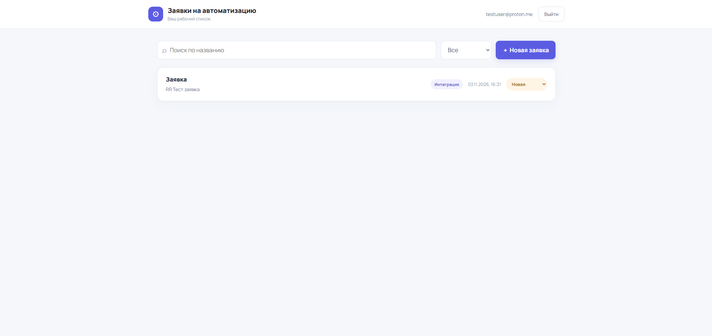
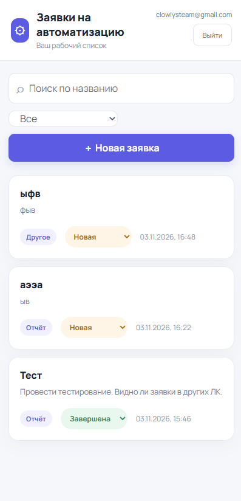
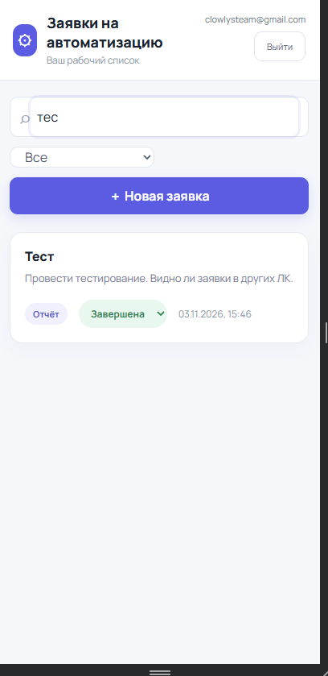
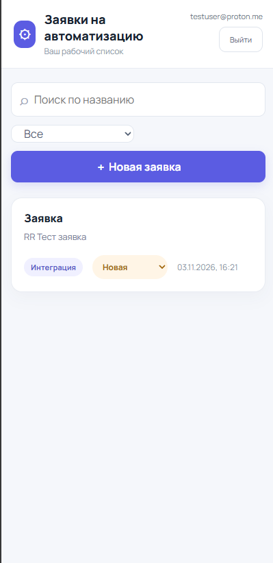
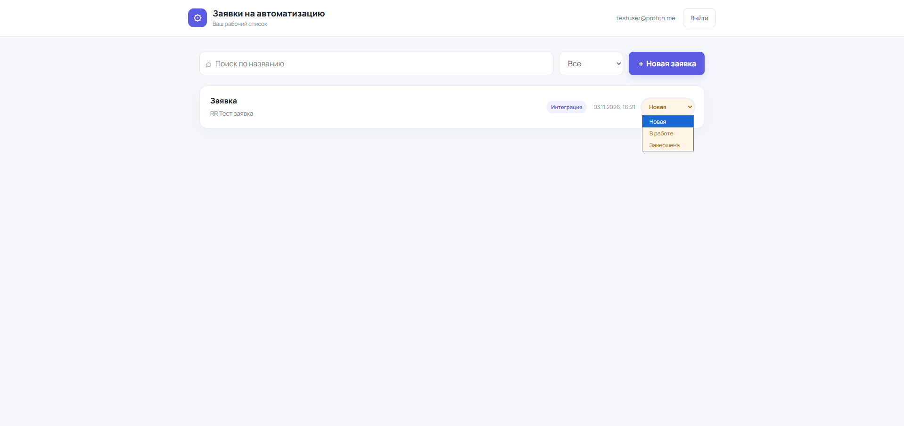
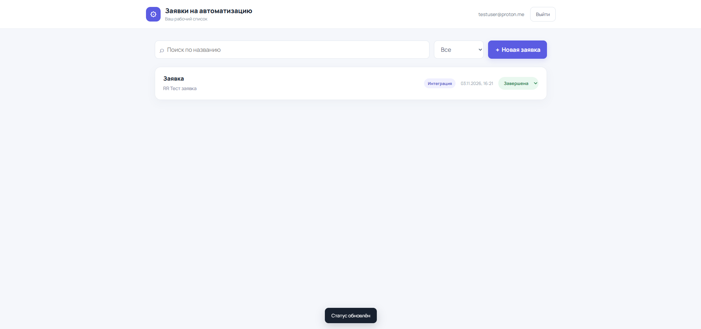

# Карточка проекта: Заявки на автоматизацию

> **Репозиторий проекта:** [https://github.com/1wm9k/automation-requests](https://github.com/1wm9k/automation-requests)  
> **Онлайн-демо:** [https://1wm9k.github.io/automation-requests/](https://1wm9k.github.io/automation-requests/)

## Стек технологий
- **Frontend:** React 19, TypeScript, Vite, Tailwind CSS
- **Backend / Database:** Supabase (PostgreSQL, Supabase Auth, Row Level Security)
- **CI/CD / Деплой:** GitHub Actions, GitHub Pages

---

## Ключевые архитектурные решения

1. **Row Level Security (RLS) и изоляция данных:**
   - Доступ на уровне строк включён на таблице `tickets`.
   - Политики `SELECT`, `INSERT`, `UPDATE`, `DELETE` строго изолированы по `user_id = (select auth.uid())` с `WITH CHECK`.
   - Прямой запрос без сессии или под чужим пользователем физически возвращает пустой результат или 0 затронутых строк.
   - Права у роли `anon` отозваны. Интеграционный тест `scripts/verify-rls.mjs` проверяет 9 сценариев доступа (PASS 9/9).
2. **Идемпотентность создания и защита от дублей:**
   - Клиент генерирует UUID (`crypto.randomUUID()`) один раз при открытии формы.
   - Повторная отправка с тем же ID перехватывается базой данных (conflict handling), не создавая дублирующих записей.
   - Кнопка отправки и поля блокируются (`disabled={busy}`, флаг `saveRef`).
3. **Поиск без race condition:**
   - Запросы к Supabase через `ilike` с экранированием спецсимволов `%` и `_`.
   - Debounce ввода 300 мс.
   - Учёт идентификатора запроса (`request.current`): запоздалые ответы сети отбрасываются.
4. **Неизменяемость системных полей:**
   - Триггер `set_updated_at` блокирует модификацию `user_id` и `created_at` при операциях UPDATE.
5. **Адаптивный интерфейс:**
   - Полнофункциональная работа на десктопе (1920 px) и на мобильных устройствах (от 320 px).
   - Быстрая смена статуса заявки прямо из карточки списка.

---

## Демонстрация интерфейса

| Сценарий | Скриншот |
| :--- | :--- |
| **Мобильный список заявок** |  |
| **Живой поиск (debounce)** |  |
| **Изоляция данных между пользователями (RLS)** |  |
| **Быстрая смена статуса из карточки** |  |
| **Результат сохранения статуса** |  |
